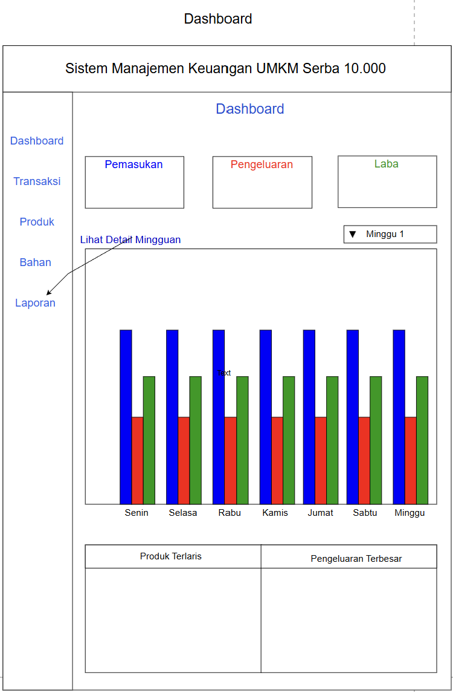
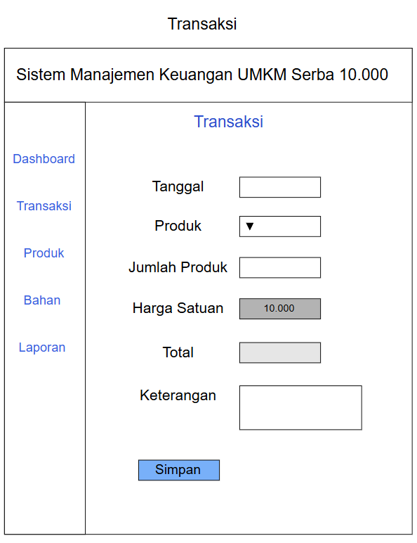
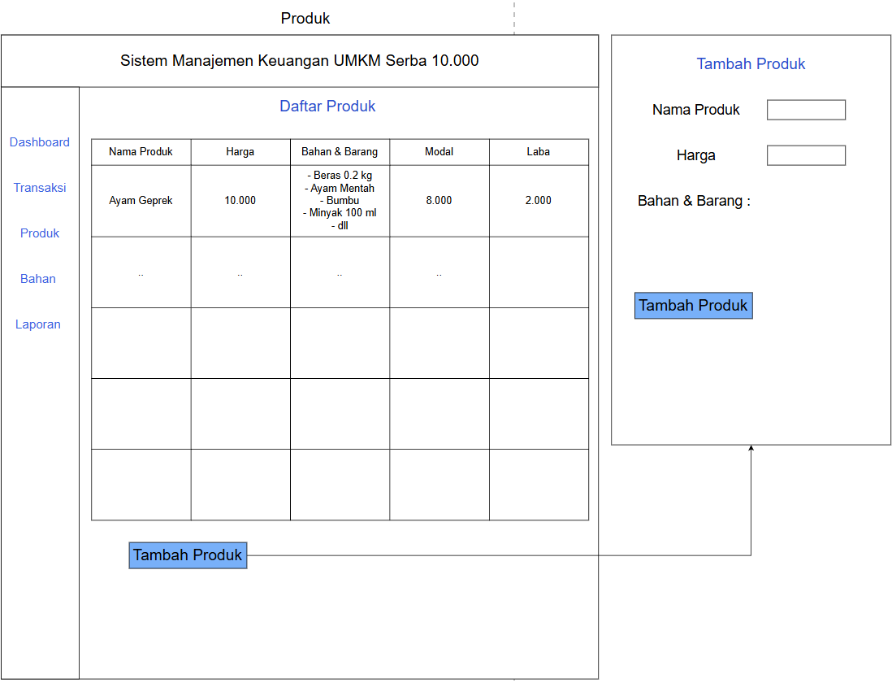
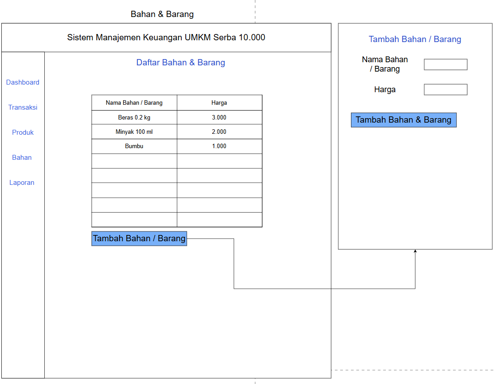
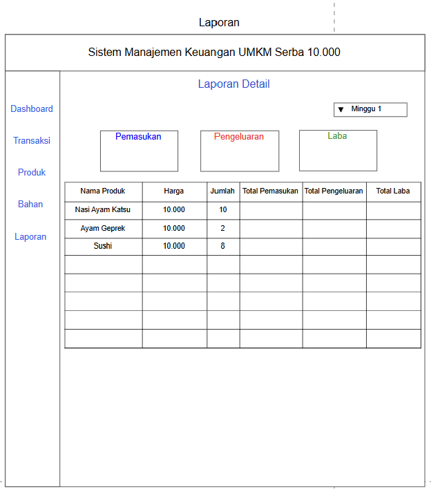
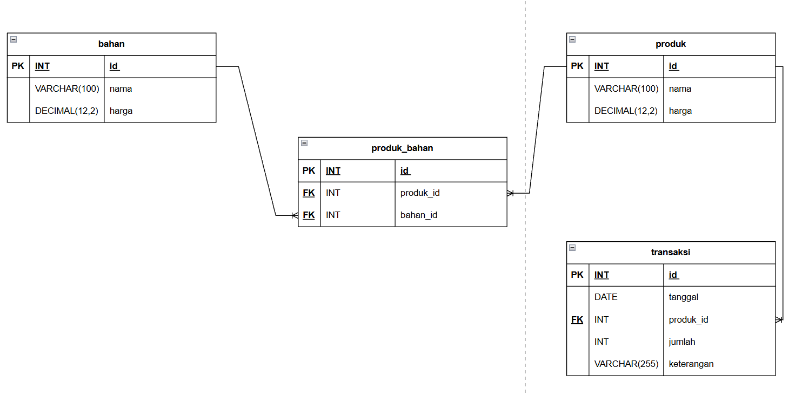

# Sistem Manajemen Keuangan UMKM Serba Rp10.000

## Deskripsi

**Sistem Manajemen Keuangan UMKM Serba Rp10.000** merupakan aplikasi desktop yang dirancang untuk membantu pemilik UMKM dalam mencatat dan memantau keuangan usaha.

Aplikasi ini berfokus pada pencatatan produk yang terjual, bahan/barang yang digunakan untuk membuat produk, serta penyajian informasi pemasukan, pengeluaran, dan laba.

Harga jual produk pada sistem ditetapkan sebesar **Rp10.000** sesuai dengan konsep UMKM yang digunakan.

---

## Tujuan Aplikasi

Aplikasi ini dibuat untuk membantu pemilik UMKM dalam:

- Mencatat produk yang berhasil terjual.
- Mencatat bahan/barang yang digunakan untuk membuat produk.
- Menentukan bahan/barang yang digunakan oleh setiap produk.
- Menghitung modal produk berdasarkan bahan/barang yang digunakan.
- Menghitung pemasukan dari produk yang terjual.
- Menghitung pengeluaran berdasarkan bahan/barang yang digunakan.
- Menghitung laba.
- Melihat ringkasan keuangan melalui dashboard.
- Melihat detail transaksi berdasarkan periode mingguan dan harian.

---

# Alur Aplikasi

### 1. Menambahkan Bahan/Barang

Pemilik terlebih dahulu memasukkan bahan/barang yang digunakan dalam pembuatan produk.

Data yang dimasukkan:

- Nama bahan/barang
- Harga bahan/barang

Contoh:

```text
Beras 0.2 kg  → Rp3.000
Ayam 100 gram → Rp5.000
Minyak 100 ml → Rp3.000
```

Informasi ukuran atau jumlah bahan/barang dituliskan langsung pada nama bahan/barang.

### 2. Menambahkan Produk

Pemilik dapat menambahkan produk yang dijual oleh UMKM.

Data produk terdiri dari:

- Nama produk
- Harga
- Bahan/barang yang digunakan

Bahan/barang yang dipilih akan digunakan untuk menentukan modal produk.

```text
Modal Produk =
Jumlah harga seluruh bahan/barang yang digunakan
```

### 3. Mencatat Transaksi

Pemilik memasukkan produk yang berhasil terjual.

Data transaksi terdiri dari:

- Tanggal
- Produk
- Jumlah produk
- Keterangan

Harga produk mengikuti harga yang telah ditentukan pada data produk dan tidak dapat diubah pada transaksi karena konsep usaha menggunakan harga Rp10.000.

Jika produk yang sama sudah tercatat pada tanggal yang sama, jumlah produk pada transaksi tersebut akan ditambahkan.

### 4. Dashboard

Dashboard menampilkan ringkasan kondisi keuangan, yaitu:

- Pemasukan
- Pengeluaran
- Laba
- Grafik 7 hari
- Produk terlaris
- Pengeluaran terbesar

Laba dihitung menggunakan:

```text
Laba = Pemasukan - Pengeluaran
```

### 5. Laporan

Menu laporan digunakan untuk menampilkan detail transaksi berdasarkan periode mingguan dan harian.

Informasi yang ditampilkan meliputi:

- Nama produk
- Harga
- Jumlah
- Total pemasukan
- Total pengeluaran
- Total laba

---

# Fungsionalitas

## Dashboard



Dashboard memberikan ringkasan informasi keuangan usaha.

---

## Transaksi



Menu transaksi digunakan untuk mencatat produk yang berhasil dijual.

Fitur utama:

- Memilih produk melalui dropdown.
- Memasukkan jumlah produk.
- Memasukkan tanggal transaksi.
- Menambahkan keterangan.
- Harga produk mengikuti harga yang telah ditentukan.
- Jika produk yang sama sudah tercatat pada tanggal yang sama, jumlahnya akan ditambahkan.

---

## Produk



Menu produk digunakan untuk melihat dan menambahkan produk yang dimiliki UMKM.

Fitur utama:

- Melihat daftar produk.
- Menambahkan produk baru.
- Memasukkan nama produk.
- Memilih bahan/barang yang digunakan.
- Menghitung modal berdasarkan bahan/barang yang dipilih.

---

## Bahan/Barang



Menu bahan digunakan untuk menyimpan bahan/barang yang diperlukan untuk membuat produk.

Fitur utama:

- Melihat daftar bahan/barang.
- Menambahkan bahan/barang baru.
- Memasukkan nama bahan/barang.
- Memasukkan harga bahan/barang.

---

## Laporan



Menu laporan digunakan untuk melihat detail keuangan berdasarkan periode.

Informasi laporan mencakup pemasukan, pengeluaran, dan laba dari produk yang terjual.

---

# Rancangan Database

Database aplikasi terdiri dari **4 tabel utama**:

1. `bahan`
2. `produk`
3. `produk_bahan`
4. `transaksi`

## ERD



### Tabel `bahan`

Digunakan untuk menyimpan bahan/barang yang menjadi pengeluaran.

| Field | Tipe Data | Keterangan |
|---|---|---|
| `id` | INT | Primary Key, Auto Increment |
| `nama` | VARCHAR(100) | Nama bahan/barang |
| `harga` | DECIMAL(12,2) | Harga bahan/barang |

### Tabel `produk`

Digunakan untuk menyimpan produk yang dijual.

| Field | Tipe Data | Keterangan |
|---|---|---|
| `id` | INT | Primary Key, Auto Increment |
| `nama` | VARCHAR(100) | Nama produk |
| `harga` | DECIMAL(12,2) | Harga jual produk |

### Tabel `produk_bahan`

Digunakan sebagai tabel penghubung antara produk dan bahan/barang.

| Field | Tipe Data | Keterangan |
|---|---|---|
| `id` | INT | Primary Key, Auto Increment |
| `produk_id` | INT | Foreign Key ke `produk.id` |
| `bahan_id` | INT | Foreign Key ke `bahan.id` |

Relasi:

```text
Produk 1 ───── N Produk_Bahan N ───── 1 Bahan
```

### Tabel `transaksi`

Digunakan untuk menyimpan data produk yang terjual.

| Field | Tipe Data | Keterangan |
|---|---|---|
| `id` | INT | Primary Key, Auto Increment |
| `tanggal` | DATE | Tanggal transaksi |
| `produk_id` | INT | Foreign Key ke `produk.id` |
| `jumlah` | INT | Jumlah produk terjual |
| `keterangan` | VARCHAR(255) | Keterangan transaksi |

Relasi:

```text
Produk 1 ───── N Transaksi
```

---

# Perhitungan Keuangan

Modal produk diperoleh dari jumlah harga seluruh bahan/barang yang digunakan oleh produk.

Contoh:

```text
Beras 0.2 kg    Rp2.000
Ayam 100 gram   Rp4.000
Minyak 100 ml   Rp2.000
------------------------
Modal           Rp8.000
```

Jika produk dijual dengan harga Rp10.000 dan terjual sebanyak 10 buah:

```text
Pemasukan
= 10 × Rp10.000
= Rp100.000
```

```text
Modal/Pengeluaran
= 10 × Rp8.000
= Rp80.000
```

```text
Laba
= Rp100.000 - Rp80.000
= Rp20.000
```

Nilai modal dan laba diperoleh melalui perhitungan berdasarkan data bahan, produk, dan transaksi.

---

# Rancangan Class

Class utama yang digunakan dalam aplikasi mengikuti struktur data dan kebutuhan sistem.

### `Bahan`

Merepresentasikan data bahan/barang.

```text
Bahan
- id : int
- nama : String
- harga : BigDecimal
```

### `Produk`

Merepresentasikan produk yang dijual.

```text
Produk
- id : int
- nama : String
- harga : BigDecimal
```

### `ProdukBahan`

Merepresentasikan hubungan antara produk dengan bahan/barang yang digunakan.

```text
ProdukBahan
- id : int
- produk : Produk
- bahan : Bahan
```

### `Transaksi`

Merepresentasikan transaksi penjualan.

```text
Transaksi
- id : int
- tanggal : LocalDate
- produk : Produk
- jumlah : int
- keterangan : String
```

---

# Kesimpulan

Sistem ini dirancang sebagai aplikasi desktop sederhana untuk membantu UMKM dalam melakukan pencatatan keuangan berdasarkan produk yang dijual dan bahan/barang yang digunakan.

Database menggunakan empat tabel utama, yaitu `bahan`, `produk`, `produk_bahan`, dan `transaksi`. Data tersebut digunakan untuk menghasilkan informasi pemasukan, pengeluaran, modal, dan laba serta menyajikannya melalui dashboard dan laporan.